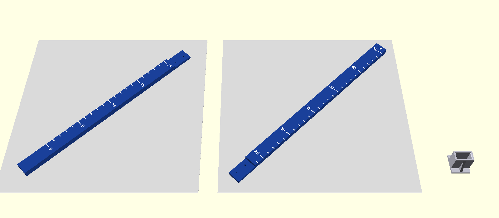

# Modelos 3D

Todas as peças impressas do levitador. Os modelos foram feitos no OpenSCAD.


## `levitador/`: estrutura do levitador

`levitador_pneumatico.scad` é o arquivo-fonte único, com **todas as peças juntas**. O parâmetro `selecao`, no topo do arquivo, escolhe o que é renderizado:

| `selecao` | Peça | STL |
|---|---|---|
| `montagem` | Montagem completa (só para visualização, inclui blower e tubo) | (imagem acima) |
| `layout` | Todas as peças na posição de impressão | n/a |
| `corpo` | Corpo do case do blower (com fundo e janela para a grade) | `stl/corpo.stl` |
| `tampa_case` | Tampa do case, com o furo de saída do blower | `stl/tampa_case.stl` |
| `bocal` | Bocal adaptador (saída retangular do blower → tubo Ø50 mm) | `stl/bocal.stl` |
| `grade` | Grade hexagonal frontal (encaixe por pressão) | `stl/grade.stl` |
| `suporte_sensor` | Suporte do sensor VL53L0X no topo do tubo | `stl/suporte_sensor.stl` |
| `tampa_sensor` | Tampa de fechamento do suporte do sensor | `stl/tampa_sensor.stl` |
| `pino` | Pino de fixação do case (imprimir 4) | `stl/pino.stl` |
| `clip` | Clipe de trava do pino (imprimir 4) | `stl/clip.stl` |
| `eletroduto` | Eletroduto dos fios do sensor, em segmentos encaixáveis (`seg = 0` gera todos) | `stl/eletroduto.stl` |
| `regua` | Régua de 0 a 50 cm em 4 segmentos, impressa em pé (versão antiga, para mesa de 180 mm) | `stl/regua.stl` |
| `marcas_regua` | Linhas e números da régua antiga, para colar nos rebaixos | `stl/marcas_regua.stl` |

Os segmentos do eletroduto e da régua têm no máximo 175 mm, para caber numa impressora de 180 mm. Para gerar só um segmento, use `seg = 1`, `2`, ...

Exportar uma peça pela linha de comando:

```
openscad -D 'selecao="corpo"' -o corpo.stl levitador_pneumatico.scad
openscad -D 'selecao="eletroduto"' -D 'seg=2' -o eletroduto2.stl levitador_pneumatico.scad
```

### Régua para impressora de 256 mm (Bambu Lab A1): `regua.scad`



Versão nova da régua, que substitui `regua` e `marcas_regua` acima. É impressa **deitada**, em 2 pedaços (278 e 306 mm) na diagonal da mesa, mais uma sapata.

- **Números embutidos nas duas faces:** as marcações ocupam só as 3 primeiras e as 3 últimas camadas (0,6 mm). A troca de cor acontece em ~6 camadas, não na régua inteira, então gasta pouca purga e imprime rápido.
- **Sem suporte:** a junta é de meia espessura (cada pedaço guarda, na ponta, só a metade que fica na mesa). Os pedaços se sobrepõem 30 mm e são travados por 2 pinos de filamento 1,75 mm (ou parafusos M2).
- **Sapata separada:** encaixa na ponta de baixo da régua e apoia na flange do bocal, como o pé da régua antiga.
- **Zero no meio do carretel em repouso:** a régua lê a mesma "Posicao" do firmware (centro do carretel, em cm acima do repouso). Pelo CAD, o carretel parado desce até a parte afunilada do bocal e o meio dele fica 1,4 mm acima da base do tubo. Para acertar pela bancada, meça da borda de cima do tubo até o carretel parado e ajuste `zero_flange` (a conta está no arquivo).

Os números são impressos **na própria régua**, com o AMS, sem nada para colar. Arquivos em `stl/regua_a1/`:

- **`regua_1.3mf` e `regua_2.3mf` (recomendado):** abra direto na Bambu Studio. Cada um é um objeto com 2 partes: o corpo usa o filamento 1 e os números o filamento 2. Basta colocar azul no slot do filamento 1 e branco no 2.
- **`regua_N_corpo.stl` + `regua_N_marcas.stl`:** as mesmas peças em STL, caso o 3MF não abra. Importe os dois **juntos**, responda "sim" para carregar como um objeto com várias partes e escolha azul para o corpo e branco para as marcas.

Use camada de 0,2 mm e nenhum suporte. As peças já vêm giradas 45° e centradas na mesa. A `regua_base.stl` é impressa em pé, numa cor só, com a abertura para cima.

Peças compradas: blower Delta BFB1012EH (9733), tubo de acrílico Ø50 mm × 500 mm, sensor VL53L0X e 2 parafusos M3 com porca.

## `carretel/`: objeto que levita

Dois discos ligados por um eixo oco. Funciona como pistão, e o disco de cima é plano para o sensor medir melhor. Imprime em duas metades, sem suporte, com 100% de preenchimento, e as metades são coladas com cola CA.

| Arquivo | Versão |
|---|---|
| `carretel.stl` | v1: usado nos ensaios do relatório e nas simulações de CFD |
| `carretel_v2.stl` | Folga menor, vão maior e discos mais grossos (piorou) |
| `carretel_v2_folga06.stl` | v2 com folga de 0,6 mm |
| `carretel_v3.stl` | Igual ao v1, só com o vão entre os discos aumentado de 30 para 45 mm |
| `carretel_v4.stl` | Borda-guia cônica (efeito Lomakin) para centralizar o carretel no tubo |
