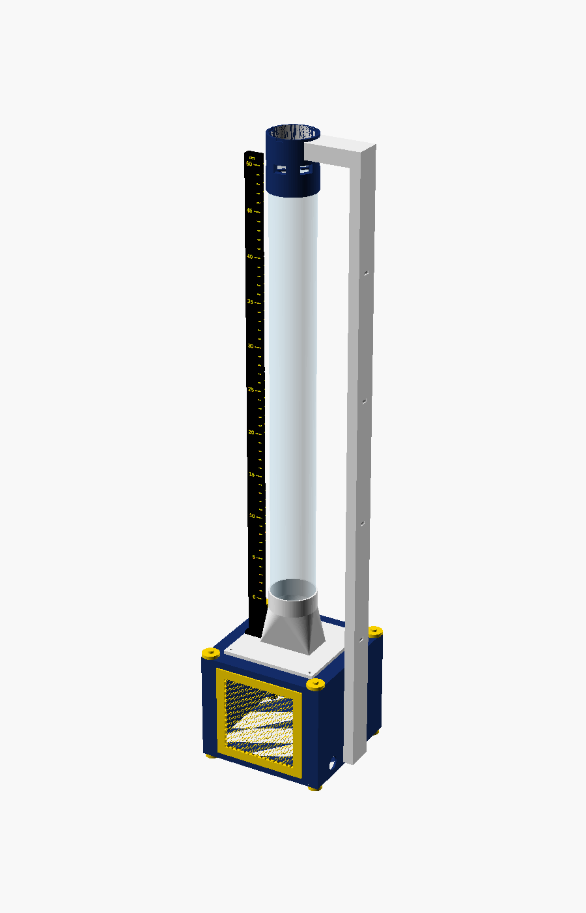

# Modelos 3D

Todas as peças impressas do levitador. Os modelos foram feitos no OpenSCAD.



## `levitador/`: estrutura do levitador

`levitador_pneumatico.scad` é o arquivo-fonte único, com **todas as peças juntas**. O parâmetro `selecao`, no topo do arquivo, escolhe o que é renderizado:

| `selecao` | Peça | STL |
|---|---|---|
| `montagem` | Montagem completa (só para visualização, inclui blower e tubo) | (imagem acima) |
| `layout` | Todas as peças na posição de impressão | n/a |
| `corpo` | Corpo do case do blower (com fundo e janela para a grade) | `stl/corpo.stl` |
| `tampa_case` | Tampa do case, com o furo de saída do blower | `stl/tampa_case.stl` |
| `bocal` | Bocal adaptador (saída retangular do blower → tubo Ø50 mm) | `stl/bocal.stl` |
| `grade` | Grade hexagonal frontal (encaixe por pressão) | `stl/grade.stl` |
| `suporte_sensor` | Suporte do sensor VL53L0X no topo do tubo | `stl/suporte_sensor.stl` |
| `tampa_sensor` | Tampa de fechamento do suporte do sensor | `stl/tampa_sensor.stl` |
| `pino` | Pino de fixação do case (imprimir 4) | `stl/pino.stl` |
| `clip` | Clipe de trava do pino (imprimir 4) | `stl/clip.stl` |
| `eletroduto` | Eletroduto dos fios do sensor, em segmentos encaixáveis (`seg = 0` gera todos) | `stl/eletroduto.stl` |
| `regua` | Régua de 0 a 50 cm, em segmentos | `stl/regua.stl` |
| `marcas_regua` | Linhas e números da régua, para imprimir em outra cor | `stl/marcas_regua.stl` |

Os segmentos do eletroduto e da régua têm no máximo 175 mm, para caber numa impressora de 180 mm. Para gerar só um segmento, use `seg = 1`, `2`, ...

Exportar uma peça pela linha de comando:

```
openscad -D 'selecao="corpo"' -o corpo.stl levitador_pneumatico.scad
openscad -D 'selecao="eletroduto"' -D 'seg=2' -o eletroduto2.stl levitador_pneumatico.scad
```

Peças compradas: blower Delta BFB1012EH (9733), tubo de acrílico Ø50 mm × 500 mm, sensor VL53L0X e 2 parafusos M3 com porca.

## `carretel/`: objeto que levita

Dois discos ligados por um eixo oco. Funciona como pistão, e o disco de cima é plano para o sensor medir melhor. Imprime em duas metades, sem suporte, com 100% de preenchimento, e as metades são coladas com cola CA.

| Arquivo | Versão |
|---|---|
| `carretel.scad` / `carretel.stl` | v1: usado nos ensaios do relatório e nas simulações de CFD |
| `carretel_v2.*` | Folga menor, vão maior e discos mais grossos (piorou) |
| `carretel_v2_folga06.stl` | v2 com folga de 0,6 mm |
| `carretel_v3.*` | Igual ao v1, só com o vão entre os discos aumentado de 30 para 45 mm |
| `carretel_v4.*` | Borda-guia cônica (efeito Lomakin) para centralizar o carretel no tubo |
